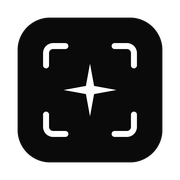
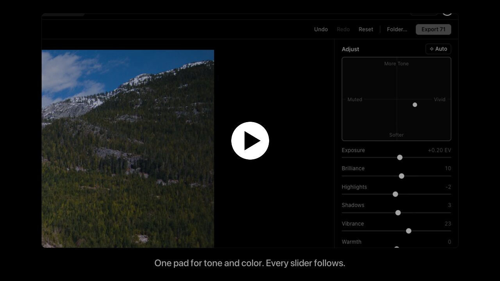

<p align="center">
  
</p>

<h1 align="center">AI Photo Culling</h1>

<p align="center">
  Cull, edit and export drone RAWs in one local app for macOS and Windows.<br>
  <b>Cull → Auto → drag a few sliders → export.</b>
</p>

<p align="center">
  <a href="https://github.com/zangjiucheng/photo-cull/releases/latest"></a>
  <a href="https://github.com/zangjiucheng/photo-cull/actions/workflows/ci.yml"></a>
</p>

<p align="center">
  <a href="https://github.com/zangjiucheng/photo-cull/releases/latest"><b>Download for macOS &amp; Windows</b></a> ·
  <a href="https://zangjiucheng.github.io/photo-cull/">Website</a> ·
  <a href="docs/getting-started.md">Docs</a>
</p>

[](https://zangjiucheng.github.io/photo-cull/#film)

## Highlights

- **AI scoring and culling.** Every photo is scored for sharpness, exposure and clipping. Filter, sort, rate and queue the keepers.
- **Near-duplicate groups.** Similar shots are grouped, with a suggested keeper in each group.
- **Camera-accurate RAW base.** DJI DNGs are developed through the camera's own tone curve, so you start from the look of the in-camera JPEG.
- **Tone/Color pad.** An Apple-style 2D pad that moves the real sliders, adapted to each photo. Fine-tune anything afterwards.
- **18 styles.** Undertones, Moods and Black & White looks, inspired by Apple Photos, each with a strength slider.
- **Clean export.** sRGB JPEG or 16-bit TIFF with ICC profile and capture metadata (no GPS). Originals are never touched.
- **Local and fast.** Everything runs on your computer and updates itself from GitHub Releases.

## Install

Grab the latest build from [Releases](https://github.com/zangjiucheng/photo-cull/releases/latest):

- **macOS** (Apple Silicon): open the DMG and drag the app into Applications.
- **Windows** 10/11 (x64): run `AI Photo Culling Setup.exe`. It installs for your user, no admin rights needed.

> [!NOTE]
> Builds aren't code signed yet, so macOS Gatekeeper or Windows SmartScreen may warn on first launch. See [Getting started](docs/getting-started.md) for how to open the app.

## Quick start

1. **Open Folder...** and let it index your photos.
2. Rate and compare in **Browse**, **Review** and **Similarity**. Press `Q` to queue the keepers.
3. In **Enhance & Export**, click **Auto**, then drag the Tone/Color pad or pick a style.
4. Choose **Share JPEG** or **Archive TIFF**, pick a folder and **Export**.

## Documentation

| | |
| --- | --- |
| [Getting started](docs/getting-started.md) | Install, first launch, updates, where your data lives |
| [Editing](docs/editing.md) | The RAW editor and every control |
| [Keyboard shortcuts](docs/shortcuts.md) | All shortcuts |
| [How it works](docs/how-it-works.md) | RAW pipeline, colour, output, performance |
| [Development](docs/development.md) | Setup, tests, packaging, releases, environment variables |
| [Release notes](docs/releases/) | What changed in each version |

## Development

```bash
python3.11 -m venv .venv && .venv/bin/pip install -r requirements-dev.txt
(cd frontend && npm ci)
make dev PYTHON="$PWD/.venv/bin/python"    # desktop app
make test PYTHON="$PWD/.venv/bin/python"   # backend + frontend tests
```

CI runs on Ubuntu, macOS and Windows. Pushing a `v*` tag builds the macOS DMG and the Windows installer and publishes a GitHub Release. See [Development](docs/development.md) for details and [Docker](docker/README.md) for the browser mode.
