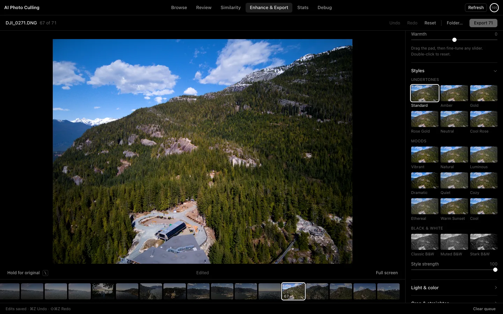

# Photo Cull

[](https://github.com/zangjiucheng/photo-cull/actions/workflows/ci.yml)
[](https://github.com/zangjiucheng/photo-cull/releases/latest)

**AI Photo Culling** is a local macOS app for culling and RAW-editing photos, built around DJI drone shots. Scoring, similar-photo review, quick adjustments, and export live in one workspace.

**Cull → Auto → drag a few sliders → export.**

Website: <https://zangjiucheng.github.io/photo-cull/>



## Documentation

- [Getting started](docs/getting-started.md): install, first run, Gatekeeper, updates
- [Editing](docs/editing.md): the quick RAW editor and its controls
- [Keyboard shortcuts](docs/shortcuts.md)
- [Development](docs/development.md): setup, run, test, package, release
- [Docker browser mode](docker/README.md)
- Release notes: [v0.3.0](docs/releases/v0.3.0.md), [v0.2.2](docs/releases/v0.2.2.md), [v0.2.1](docs/releases/v0.2.1.md), [v0.2.0](docs/releases/v0.2.0.md)
- Background: [quick RAW editing research](docs/research/quick-raw-editing.md), [implementation and validation record](docs/validation/quick-raw-editor.md)

## Install

Download the macOS Apple Silicon (arm64) DMG from [GitHub Releases](https://github.com/zangjiucheng/photo-cull/releases/latest), open it, and drag **AI Photo Culling.app** into Applications.

The Python backend needed for basic scoring, RAW editing, and export is bundled, so you don't need to install Python. Builds are **not** signed with a Developer ID or notarized, so macOS Gatekeeper may block the first launch; see [Getting started](docs/getting-started.md#first-launch-and-gatekeeper) for how to open it. Intel Macs, Windows, and Linux don't have verified builds yet.

### Updates

The app checks GitHub Releases for a new version on every launch, and you can check manually from **AI Photo Culling → Check for Updates...**. When you accept an update, the app downloads the zip for your architecture, verifies it against `SHA256SUMS.txt`, checks the bundled version, and then replaces the `.app` and relaunches (right away, or the next time you quit). If the replacement fails, the previous version is restored.

In-place updates need the app to live in a writable folder such as `/Applications`; when it runs straight from the DMG, the release page opens instead. Set `AI_CULLING_DISABLE_UPDATES=1` to turn update checks off. v0.2.0 and earlier have no updater and need a one-time manual install.

## Features

| Workspace | What it does |
| --- | --- |
| Browse | Folder workspace with grid/list views, filename search, minimum AI score, star filter, sorting (score, name, date), and an Inspector with score reasons, model metrics, photo signals, and a manual score override |
| Review | One photo at a time with a resizable preview, zoom, star rating, and queue toggle; **AI Rate Folder** scores the whole folder |
| Similarity | Groups similar and duplicate photos (pHash first, then CLIP + FAISS when available), suggests a keeper per group, and removes the rest from the workspace; originals stay on disk and can be restored |
| Enhance & Export | Quick RAW editor for the export queue and the batch export |
| Stats | Rating coverage, filter retention, queue size, and background scoring progress |
| Debug | Installs the optional AI runtime and shows its install log |

**Scoring.** Every photo gets a score from built-in signals (sharpness, exposure, contrast, clipping, brightness). With the optional AI runtime installed, image-quality models (via pyiqa) also contribute. Stars and manual overrides are kept when you refresh AI scores.

**Quick RAW editor** (Enhance & Export):

| Area | Controls |
| --- | --- |
| Base | DJI DNGs are developed through the tone curve embedded in the DNG (the curve the in-camera JPEG and Lightroom use), so the starting point already looks like the camera's JPEG |
| Auto | Conservative per-photo suggestions with an Auto strength slider; clicking Auto again replaces the previous result |
| Tone/Color pad | Apple-style 2D pad (More Tone ↔ Softer, Muted ↔ Vivid) that moves the real sliders, adapted per photo |
| Everyday sliders | Exposure, Brilliance, Highlights, Shadows, Vibrance, Warmth |
| Styles | 18 Apple Photos-style looks in three groups: Undertones (Standard, Amber, Gold, Rose Gold, Neutral, Cool Rose), Moods (Vibrant, Natural, Luminous, Dramatic, Quiet, Cozy, Ethereal, Warm Sunset, Cool) and Black & White (Classic, Muted, Stark), previewed on the current photo, with Style strength |
| Light & color | Contrast, Black point, Dehaze, Saturation, Tint, Definition, clipping overlay |
| Crop & straighten | Non-destructive crop, Original / 1:1 / 4:3 / 3:2 / 16:9 / 9:16, ±15° straighten, rule-of-thirds grid |
| Batch | Selective copy/paste by group, Apply to queue, personal presets saved on this device |
| Export | Share JPEG / Archive TIFF presets; sRGB JPEG or 16-bit sRGB TIFF, JPEG quality, longest edge, per-photo recipes, filename de-duplication |

Editing happens locally. Opening a folder indexes the photos in place; edit recipes are stored separately and export never overwrites originals. The optional AI runtime needs a network connection to install dependencies and fetch models, and is not required for basic editing. See [Editing](docs/editing.md) for the full workflow.

## Quick start

1. Click **Open Folder...** and wait for indexing to finish.
2. Rate and compare photos in **Browse / Review / Similarity**, and add the ones you want to finish to the export queue (`Q`).
3. Open **Enhance & Export**, click **Auto**, then drag the Tone/Color pad or the sliders, or pick a style.
4. Open **Crop & straighten** to frame the shot. To give the queue a consistent look, use **Copy adjustments & presets** and pick the groups to copy; by default each photo keeps its own exposure, white balance, and crop.
5. Choose **Share JPEG** or **Archive TIFF**, set the output folder, and click **Export**. Every photo uses its own recipe.

Edits save automatically and the status bar shows the save state. Undo history holds up to 50 steps for the current session. See [Keyboard shortcuts](docs/shortcuts.md).

## RAW, color, and output

- New (v2) recipes develop RAW with rawpy at 16 bits, fixed exposure, and camera white balance, then keep float32 for the base processing. DJI DNGs with an embedded `ProfileToneCurve` go through it with a +0.6 EV lift and hue-preserving application. DNGs without a tone curve develop as before.
- GPU preview and CPU export share the style data and adjustment math. Browse thumbnails still use fast previews.
- Warmth is relative to the camera white balance, not a Kelvin re-development. Highlights cannot recover detail that is clipped on the sensor.
- Resizing, sharpening, and cropping stay in floating point; output is quantized to 8 bits for JPEG and 16 bits for TIFF only at the final write. Preview and full-size export can differ slightly in interpolation and detail.
- Output embeds an sRGB ICC profile, keeps supported camera, exposure, date, and author metadata, and updates orientation and size. GPS, XMP, and MakerNote are not copied.
- v1 recipes from before v0.2.0 keep the legacy engine and show **Legacy edit preserved**; **Use new controls** switches to the new base and starts from neutral (undo brings the old recipe back).
- Noise reduction is a traditional filter (OpenCV non-local means, or a Pillow fallback); Real-ESRGAN upscaling needs the optional runtime. Both are off by default and run through an 8-bit image when enabled.
- 16-bit TIFFs written by this app can be re-imported at full precision; other 16-bit TIFFs with other ICC profiles aren't supported yet.

Performance (from the [v0.3.0 notes](docs/releases/v0.3.0.md)): switching back to an opened photo takes about 0.01 s instead of about 2.7 s, preview rendering about 0.09 s instead of 0.7 s, and a batch export of 3 full-size JPEGs about 3.5–4.7 s instead of about 12–13.6 s, with identical output pixels.

Initial checks used 24 DJI FC3170 4000×3000 DNGs. High-ISO real night scenes, 48 MP RAWs, memory use over long sessions, and the optional model runtime are not fully validated yet. Details are in the [validation record](docs/validation/quick-raw-editor.md).

## Development

Python **3.11** is verified; CI uses Node.js **24** and npm.

```bash
git clone https://github.com/zangjiucheng/photo-cull.git
cd photo-cull
python3.11 -m venv .venv
source .venv/bin/activate
python -m pip install -r requirements-dev.txt
cd frontend && npm ci && cd ..
make dev PYTHON="$PWD/.venv/bin/python"       # desktop app
make dev-web PYTHON="$PWD/.venv/bin/python"   # browser only, http://127.0.0.1:5050
make test PYTHON="$PWD/.venv/bin/python"
```

Build a DMG for the local architecture with `make package-dmg PYTHON=python3.11` (output in `release/`). Pushing a `v*` tag runs the release workflow, which tests, builds the DMG and update zip, writes `SHA256SUMS.txt`, and publishes a GitHub Release. See [Development](docs/development.md) for details.

Docker runs the browser mode locally; see the [Docker notes](docker/README.md). The app has no account authentication, so Docker binds to the loopback address only.

## Data

On macOS, desktop data lives in `~/Library/Application Support/AI Photo Culling/`: the SQLite workspace database, preview caches, and logs. Back up the database together with your photo folders; a workspace file (**File → Save Workspace File...**, `⌘S`) only records folder references. Installing a new version doesn't clear this data.

| Variable | Purpose |
| --- | --- |
| `DB_PATH` | Override the SQLite database path |
| `UPLOAD_FOLDER` | Upload folder for the browser backend; managed by the app on desktop |
| `RAW_RENDER_CACHE` | RAW browse preview cache folder |
| `FLASK_HOST` / `FLASK_PORT` | Browser backend bind address and port; development default `127.0.0.1:5050` |
| `AI_CULLING_DISABLE_UPDATES` | Set to `1` to disable update checks |

Code layout: `frontend/src` is the React / TypeScript UI, `frontend/electron` the desktop shell (including the updater), and `server` the Flask backend, RAW processing, and export queue.
